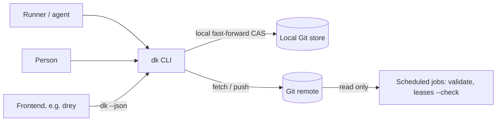
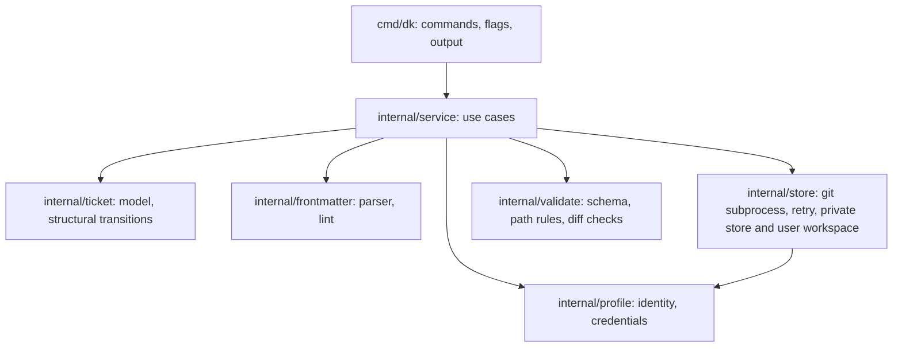
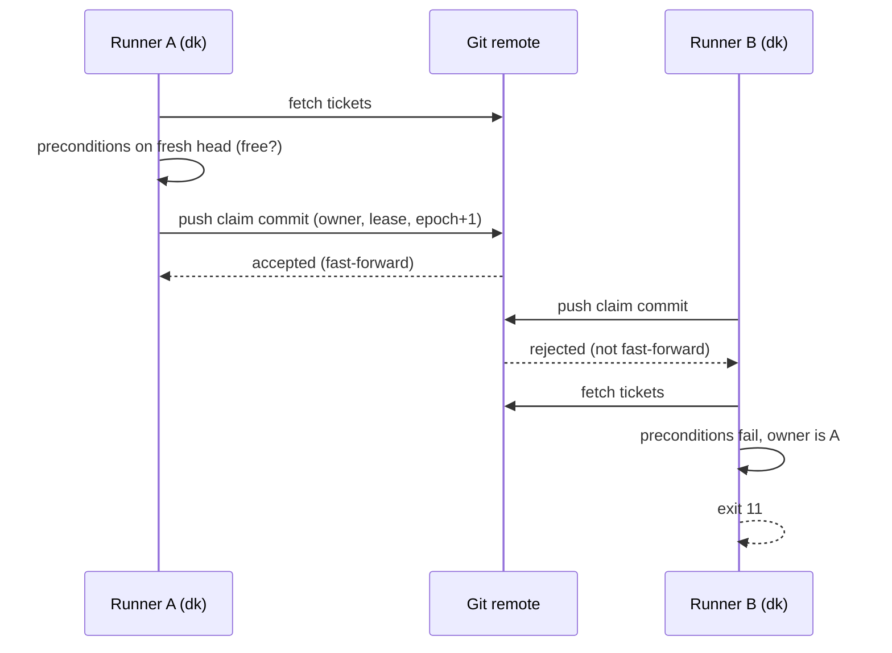

# dricket — Architecture (arc42, lean)

Status of this document: describes the current system and is updated whenever
a building block, an interface or a cross-component flow changes. The detailed
specification and the reasoning are in [CONCEPT.md](CONCEPT.md).

## 1. Introduction and goals

dricket coordinates humans and AI agents working on the same tickets, with
Markdown files in a Git repository and no server of its own.

Top quality goals:

1. **Exclusivity.** At most one owner per ticket at any time.
2. **Readability.** A ticket is a plain Markdown file a person can read and edit.
3. **Safety for agents.** A stale or misbehaving agent cannot corrupt state.
4. **Operability.** Nothing to run besides Git and one binary.
5. **Portability.** Same behaviour on Linux and macOS; Windows is a later goal.

Stakeholders: runners (agents), people working tickets, frontends such as drey,
maintainers of the ticket repository.

## 2. Constraints

- The selected Git repository is the only shared system. No extra service.
- `git` must be installed; it is called as a subprocess (ADR-0002).
- GPL-3.0-or-later; dependencies must be GPLv3-compatible (ADR-0003).
- Ticket content is untrusted input.
- Development happens on Windows and Linux; the CI matrix (ubuntu, macOS)
  is what proves the supported platforms. Windows binaries ship without a
  behaviour guarantee.
- Local non-bare stores write without a network. Remote writes need the network;
  a selected remote never silently falls back to local CAS.

## 3. Context and scope



Data in: commands and flags. Data out: text, `--json`, exit codes. The selected
local or remote store holds ticket files and the protected configuration.

## 4. Solution strategy

- Claims, IDs and writes publish to one branch by fast-forward CAS: push for
  remote/bare stores, atomic ref updates for local non-bare stores (ADR-0010).
- Two branches with different rights: protected `main` (config), writable `tickets`.
- Trusted collaborators edit whole tickets; identity and coordination invariants are validated.
- Leases by size and an `epoch` as cooperative fencing token, instead of heartbeats.
- Structural snapshot and transition rules are checked over each commit diff.
- Go and a static binary (ADR-0002).

## 5. Building block view (static)

### 5.1 Level 1



| Component | Responsibility | Owns (path) |
|---|---|---|
| CLI | Parse arguments, print data and messages, map errors to exit codes | `cmd/dk/` |
| service | One function per use case (claim, sync-backed commit, release, extend, ...) | `internal/service/` |
| ticket | Ticket model and structural transition invariants | `internal/ticket/` |
| config | dricket.toml: lease limits, admins, quota, command policies | `internal/config/` |
| frontmatter | Strict parser for the flat front matter, lint | `internal/frontmatter/` |
| store | Git subprocess, CAS loop, private store and safe user workspace | `internal/store/` |
| validate | Structural and path rules over snapshots and commit diffs | `internal/validate/` |
| profile | Git identity and credential source per profile | `internal/profile/` |

### 5.2 Level 2
Not needed yet.

## 6. Runtime view (dynamic)

### 6.1 Claim



### 6.2 Write by a former owner (fencing)
The runner's next write fetches the head and checks `owner == me && epoch ==
mine`. If the claim was taken over, the write is refused with exit 13 and the
runner stops. Local changes are kept. This is cooperative fencing and does
not stop external side effects.

### 6.3 Whole-ticket edit

```mermaid
sequenceDiagram
  participant U as User checkout
  participant D as dk private store
  participant R as Git remote
  U->>U: sync clean checkout, then edit ticket.md
  U->>D: commit(id): exact base and edited content
  D->>R: fetch fresh head
  D->>D: require remote ticket == base; owner and structural transition valid
  D->>R: commit and fast-forward push
  R-->>D: accepted
  D-->>U: adopt accepted commit only if published file is still the sole dirty path
```

A comment or unrelated ticket change does not invalidate the exact ticket base.
A same-ticket change returns exit 12 and leaves the user edit untouched. Local
whole-ticket commits publish by expected-old ref CAS before the same guarded
adoption; ordinary local writes fast-forward a checked-out branch without
overwriting pre-existing dirty paths (ADR-0010).

## 7. Deployment view

One static binary per platform (`dricket`, alias `dk`), built by GoReleaser from
a tag, with SHA-256 checksums and a build provenance attestation. Runners
install it next to `git`. The ticket repository is an ordinary repository on
any Git host with branch protection. The landing page is served by GitHub Pages
from `site/`.

CI (GitHub Actions) runs on every push and pull request: build, vet,
golangci-lint, tests with the race detector including the multi-process
concurrency tests, a fuzz smoke test, govulncheck, a licence check
(GPLv3-compatible dependencies only) and the docs consistency check. CodeQL
scans the Go code weekly. Releases are tags built by GoReleaser for linux,
macOS and Windows on amd64 and arm64, with SHA-256 checksums and a build
provenance attestation. Action versions are pinned by commit SHA;
Dependabot keeps the pins current.

## 8. Cross-cutting concepts

- **Errors:** every failure maps to a documented exit code; transport errors
  distinguish definite failure from an unknown push outcome (exit 15).
- **Configuration:** flags, then environment, then project, then user file;
  profiles live in the user file outside any repository.
- **Consistency:** accepted remote pushes or local fast-forward ref updates on
  one ref are ordered; reads are immutable snapshots; no cross-branch,
  cross-repository or external atomicity.
- **Security:** repository writers are trusted collaborators. Ticket text is
  untrusted; no shell strings; ref names checked; size limits; host branch
  rights. Validation proves structural integrity, not actor truthfulness.
- **Persistence:** only Git. Private working copies are disposable; a user
  checkout with uncommitted edits is not.
- **Logging:** stderr messages only; no telemetry; no user content in logs.
- **Testing:** unit tests for parser, lint and structural transitions;
  exit-code and JSON contract tests; real multi-process concurrency tests;
  whole-file editing, comment and unknown-push regressions; front-matter
  fuzzing. The throwaway spike harness lives under `spike/` only.

## 9. Architecture decisions
Index only; details in `docs/adr/`.

| ADR | Title | Status |
|---|---|---|
| [0001](adr/0001-claim-by-push.md) | Claims are decided by a Git push | accepted |
| [0002](adr/0002-go-and-git-cli.md) | Go, with git invoked through the git CLI | accepted |
| [0003](adr/0003-gpl-3-or-later.md) | License GPL-3.0-or-later | accepted |
| [0004](adr/0004-stage-v2-config-and-exit-codes.md) | Stage v2: dricket.toml, TOML library, new exit codes | accepted |
| [0005](adr/0005-ticket-priorities.md) | Ticket priorities (stage v2) | accepted |
| [0006](adr/0006-next-orders-by-priority.md) | next orders by priority first | accepted |
| [0007](adr/0007-comment-naming.md) | Comments named by timestamp and author | accepted |
| [0008](adr/0008-discovery-and-project-resolution.md) | Git-like store discovery and project resolution | accepted |
| [0009](adr/0009-collaborative-whole-ticket-editing.md) | Collaborative whole-ticket editing | accepted |
| [0010](adr/0010-local-and-remote-cas.md) | Local ref CAS and remote push CAS | accepted |

## 10. Quality requirements

| Goal | Scenario | Target |
|---|---|---|
| Exclusivity | 10 clones claim and release random tickets for 10 minutes | 0 tickets with two owners, 0 duplicate IDs, 0 lost updates |
| Safety | A runner with an expired lease writes after a takeover | write refused, exit 13 |
| Integrity | A collaborator edits identity or claim fields inconsistently | `dk commit` rejects the transition; history validation reports direct writes |
| Preservation | A commit fails or the same ticket changes remotely | local edits remain untouched; exit 12 for a same-ticket conflict |
| Collaboration | A comment lands during a claimed ticket edit | commit succeeds and preserves both comment and edit |
| Readability | A person edits a whole ticket in an editor | `dk commit` accepts valid content or names the invalid field |
| Operability | A fresh runner installs the binary | works with only `git` present |

Performance claims require measurements at the real host: p50/p95/p99 and
final-failure rates per write, interactive reads at representative ticket
counts, fetch size, and full-history validation time and memory. Local
correctness spikes do not establish those thresholds.

## 11. Risks and technical debt

| Risk | Owner | Trigger to revisit |
|---|---|---|
| Git contention under real load | maintainer | spike passed at ~100× assumed load; first run against the real host |
| No merge gate for epoch trailers | maintainer | first code-repo host chosen |
| Path-level push rules unavailable on a GitHub free plan | path rules are detected by `validate`, not prevented | first real ticket store on a free-plan host |
| Credentials for non-developer frontend users | maintainer | first frontend integration |
| GPL bundling inside a proprietary app | maintainer | before any bundling |

## 12. Glossary

| Term | Meaning |
|---|---|
| Claim | Exclusive right to change a ticket, taken by fast-forward CAS |
| Lease | Time limit of a claim, set by size S, M or L |
| Epoch | Counter raised on every claim or takeover; fencing token |
| Profile | Git identity and credentials used for one agent |
| Runner | An agent process that claims and works tickets |
