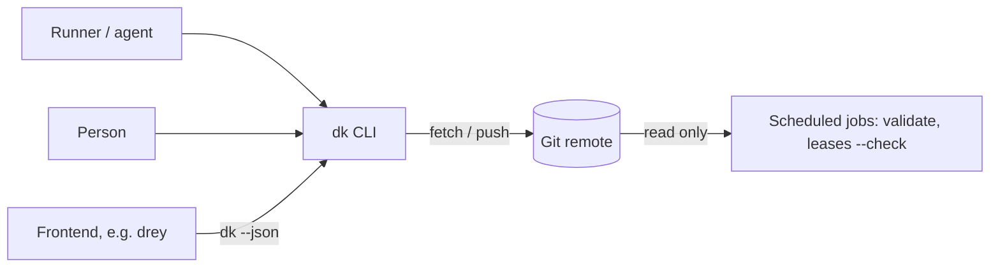
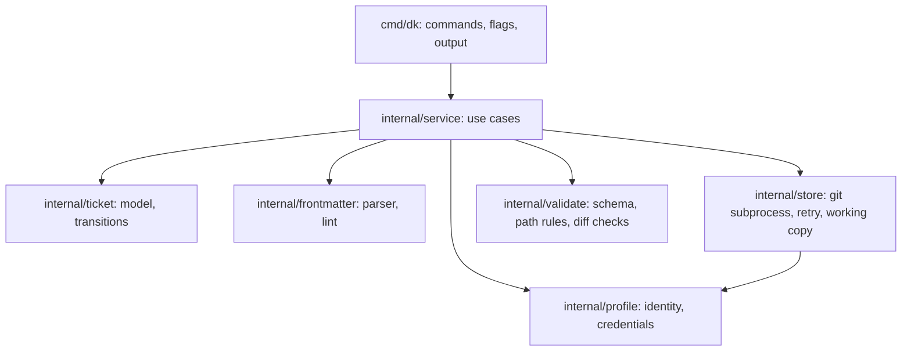
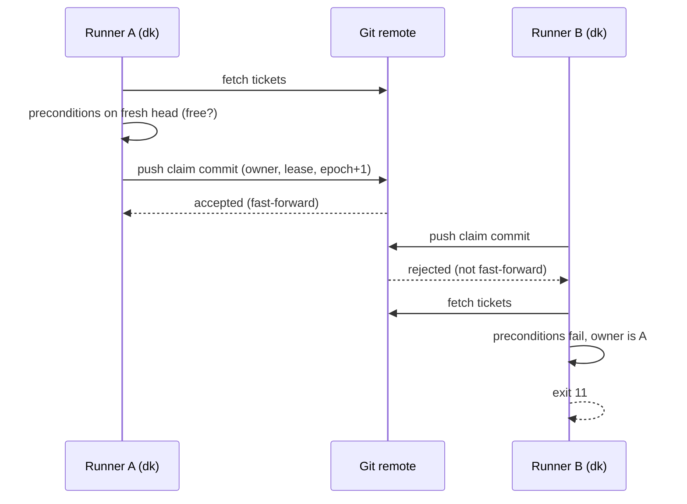

# dricket — Architecture (arc42, lean)

Status of this document: describes the intended system. No code exists yet;
the building blocks below are planned names and may change. From the first
release on it describes the current system and is updated whenever a building
block, an interface or a cross-component flow changes. The detailed
specification and the reasoning are in [CONCEPT.md](CONCEPT.md).

## 1. Introduction and goals

dricket coordinates humans and AI agents working on the same tickets, with
Markdown files in a Git repository and no server of its own.

Top quality goals:

1. **Exclusivity.** At most one owner per ticket at any time.
2. **Readability.** A ticket is a plain Markdown file a person can read and edit.
3. **Safety for agents.** A stale or misbehaving agent cannot corrupt state.
4. **Operability.** Nothing to run besides Git and one binary.
5. **Portability.** Same behaviour on Linux and macOS; Windows is a later goal.

Stakeholders: runners (agents), people working tickets, frontends such as drey,
maintainers of the ticket repository.

## 2. Constraints

- The Git remote is the only shared system. No extra service.
- `git` must be installed; it is called as a subprocess (ADR-0002).
- GPL-3.0-or-later; dependencies must be GPLv3-compatible (ADR-0003).
- Ticket content is untrusted input.
- Development happens on Windows and Linux; the CI matrix (ubuntu, macOS)
  is what proves the supported platforms. Windows binaries ship without a
  behaviour guarantee.
- Writes need the network. Offline writing is out of scope.

## 3. Context and scope

Data in: commands and flags. Data out: text, `--json`, exit codes. The remote
holds ticket files and the protected configuration.

## 4. Solution strategy

- Claims, IDs and writes are pushes to one branch (ADR-0001).
- Two branches with different rights: protected `main` (config), writable `tickets`.
- State belongs to the tool; identity is immutable; free fields are validated.
- Leases by size and an `epoch` as fencing token, instead of heartbeats.
- A declarative schema with path rules, checked over the diff of each commit.
- Go and a static binary (ADR-0002).

## 5. Building block view (static)

### 5.1 Level 1

| Component | Responsibility | Owns (path) |
|---|---|---|
| CLI | Parse arguments, print data and messages, map errors to exit codes | `cmd/dk/` |
| service | One function per use case (claim, release, extend, ...) | `internal/service/` |
| ticket | Ticket model, field classes, stage transitions per role | `internal/ticket/` |
| config | dricket.toml: lease limits, admins, quota, transitions | `internal/config/` |
| frontmatter | Strict parser for the flat front matter, lint | `internal/frontmatter/` |
| store | Git as subprocess, fetch/commit/push loop, backoff, private working copy | `internal/store/` |
| validate | Schema and path rules, immutability over the commit diff | `internal/validate/` |
| profile | Git identity and credential source per profile | `internal/profile/` |

### 5.2 Level 2
Not needed yet.

## 6. Runtime view (dynamic)

### 6.1 Claim

### 6.2 Write by a former owner (fencing)
The runner's next write fetches the head and checks `owner == me && epoch ==
mine`. If the claim was taken over, the write is refused with exit 13 and the
runner stops. Local changes are kept.

## 7. Deployment view

One static binary per platform (`dricket`, alias `dk`), built by GoReleaser from
a tag, with SHA-256 checksums and a build provenance attestation. Runners
install it next to `git`. The ticket repository is an ordinary repository on
any Git host with branch protection. The landing page is served by GitHub Pages
from `site/`.

CI (GitHub Actions) runs on every push and pull request: build, vet,
golangci-lint, tests with the race detector including the multi-process
concurrency tests, a fuzz smoke test, govulncheck, a licence check
(GPLv3-compatible dependencies only) and the docs consistency check. CodeQL
scans the Go code weekly. Releases are tags built by GoReleaser for linux,
macOS and Windows on amd64 and arm64, with SHA-256 checksums and a build
provenance attestation. Action versions are pinned by commit SHA;
Dependabot keeps the pins current.

## 8. Cross-cutting concepts

- **Errors:** every failure maps to a documented exit code (see CONCEPT.md).
- **Configuration:** flags, then environment, then project, then user file;
  profiles live in the user file outside any repository.
- **Security:** ticket text is untrusted; no shell strings; ref names checked;
  size limits; branch-level rights on the host; edits around the tool are
  detected by `validate`, not prevented.
- **Persistence:** only Git. The private working copy is disposable.
- **Logging:** stderr messages only; no telemetry; no user content in logs.
- **Testing:** unit tests for the parser, lint, validate and state
  transitions; exit-code and JSON contract tests; multi-process concurrency
  tests against a local bare repo with invariants at zero; a fuzz test for
  the front-matter parser. The throwaway spike harness lives under `spike/`
  only and is not part of the product.

## 9. Architecture decisions
Index only; details in `docs/adr/`.

| ADR | Title | Status |
|---|---|---|
| [0001](adr/0001-claim-by-push.md) | Claims are decided by a Git push | accepted |
| [0002](adr/0002-go-and-git-cli.md) | Go, with git invoked through the git CLI | accepted |
| [0003](adr/0003-gpl-3-or-later.md) | License GPL-3.0-or-later | accepted |
| [0004](adr/0004-stage-v2-config-and-exit-codes.md) | Stage v2: dricket.toml, TOML library, new exit codes | accepted |
| [0005](adr/0005-ticket-priorities.md) | Ticket priorities (stage v2) | accepted |
| [0006](adr/0006-next-orders-by-priority.md) | next orders by priority first | accepted |
| [0007](adr/0007-comment-naming.md) | Comments named by timestamp and author | accepted |

## 10. Quality requirements

| Goal | Scenario | Target |
|---|---|---|
| Exclusivity | 10 clones claim and release random tickets for 10 minutes | 0 tickets with two owners, 0 duplicate IDs, 0 lost updates |
| Safety | A runner with an expired lease writes after a takeover | write refused, exit 13 |
| Readability | A person edits a free field in an editor | `dk lint` accepts it or names the line |
| Operability | A fresh runner installs the binary | works with only `git` present |

## 11. Risks and technical debt

| Risk | Owner | Trigger to revisit |
|---|---|---|
| Git contention under real load | maintainer | spike passed at ~100× assumed load; first run against the real host |
| No merge gate for epoch trailers | maintainer | first code-repo host chosen |
| Path-level push rules unavailable on a GitHub free plan | path rules are detected by `validate`, not prevented | first real ticket store on a free-plan host |
| Credentials for non-developer frontend users | maintainer | first frontend integration |
| GPL bundling inside a proprietary app | maintainer | before any bundling |

## 12. Glossary

| Term | Meaning |
|---|---|
| Claim | Exclusive right to change a ticket, taken by a push |
| Lease | Time limit of a claim, set by size S, M or L |
| Epoch | Counter raised on every claim or takeover; fencing token |
| Profile | Git identity and credentials used for one agent |
| Runner | An agent process that claims and works tickets |
